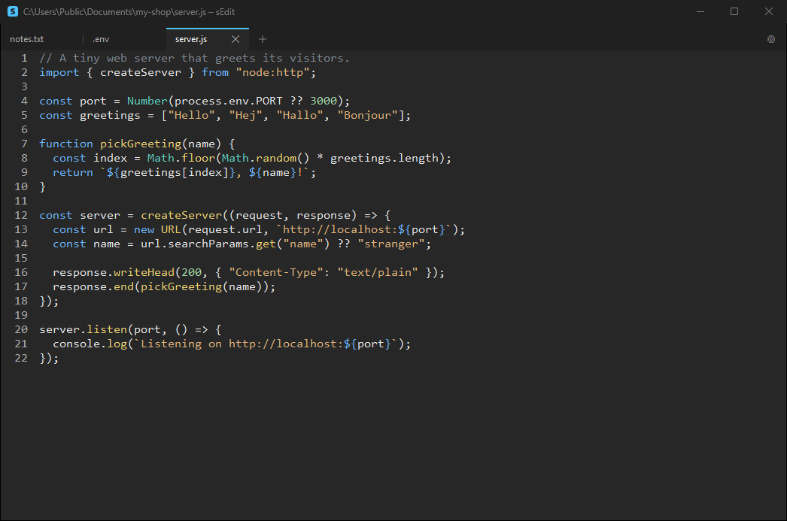
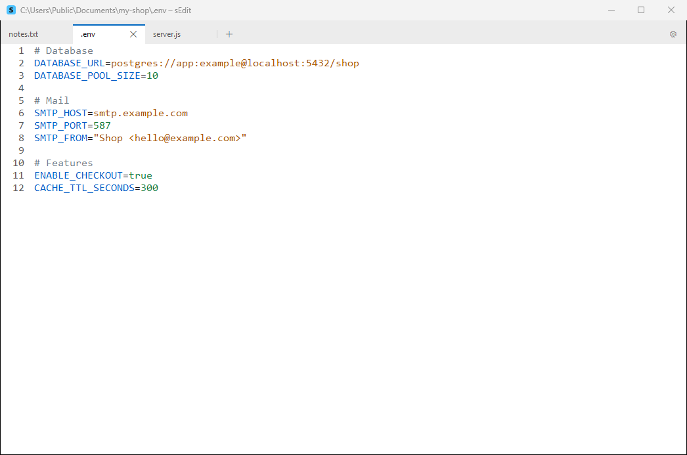
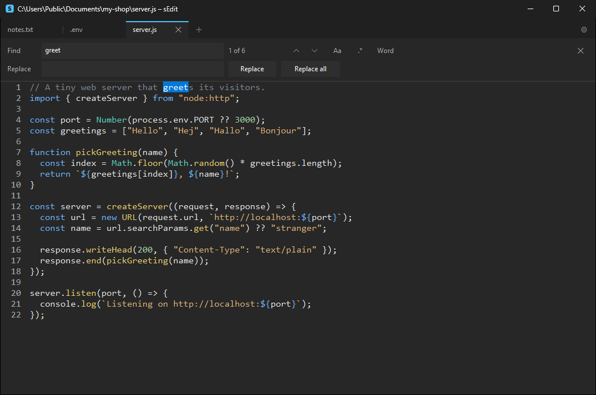
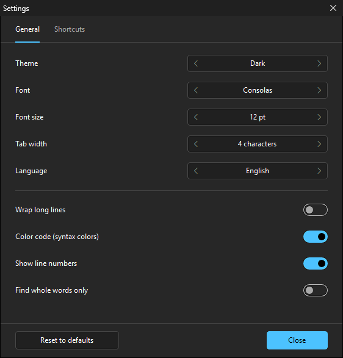

<div align="center">

# sEdit

**En lillebitte, lynhurtig notesblok med faner — til Windows.**

Den er åben i samme øjeblik du klikker, husker alt hvad du har skrevet,
og blander sig ikke.

[**⬇ Hent sEdit til Windows**](https://github.com/Andreas-DEV/sEdit/releases/latest/download/sEdit.exe)

<sub>Én lille fil · Gratis · Ingen installation · Ingen konto · Windows 10 og 11</sub>

<br>



<sub>🇬🇧 [Read in English](README.md)</sub>

</div>

## Hvad er sEdit?

sEdit er en notesblok. Du åbner den, du skriver, du gemmer. Mere er der ikke i det.

Den er lavet til de små tekstopgaver, du har hver dag: skrive en note ned,
rette en linje i en indstillingsfil, eller gemme noget du lige skal bruge om
fem minutter. Store programmer er længe om at starte og fulde af knapper.
sEdit er åben, før du har sluppet musen.

## Hvad kan den?

- **Faner.** Hav mange filer åbne i ét vindue, og klik dig mellem dem.
- **Den mister aldrig din tekst.** Lukker du sEdit uden at gemme, er dine faner
  og din ugemte tekst der stadig, næste gang du åbner den.
- **Søg og erstat.** Søg i teksten, hop fra fund til fund, og byt ét ord ud
  med et andet.
- **Farver på kode.** Åbner du en kode- eller indstillingsfil, farver sEdit
  den, så den er lettere at læse. Den kender over 30 slags filer, blandt andet
  `.env`, JSON, HTML, CSS, JavaScript, Python og Markdown.
- **Lys og mørk.** sEdit følger udseendet i din Windows, eller du vælger selv.
- **Dit sprog.** 20 sprog, blandt andet dansk, engelsk, tysk, fransk og
  spansk. Den vælger selv det sprog, din Windows bruger.
- **Den opdager ændringer.** Hvis et andet program ændrer en fil, du har åben,
  siger sEdit til og spørger, hvad du vil. Den overskriver aldrig dit arbejde
  uden at spørge.
- **Lille.** Hele programmet er én fil, mindre end et enkelt billede fra din
  telefon.

| Lys tilstand | Søg og erstat |
| :---: | :---: |
|  |  |

<sub>Billederne viser sEdit på engelsk. På en dansk computer er den på dansk.</sub>

## Sådan installerer du

Der er ikke noget at installere. sEdit er én fil. Du henter den og åbner den.

### Trin 1 — Hent

Klik på dette link:

### [⬇ Hent sEdit.exe](https://github.com/Andreas-DEV/sEdit/releases/latest/download/sEdit.exe)

Din browser gemmer en fil, der hedder **sEdit.exe**. Den havner i mappen
**Overførsler**.

### Trin 2 — Åbn den

Åbn mappen **Overførsler**, og dobbeltklik på **sEdit**.

> **Kan du ikke finde mappen Overførsler?**
> Hold **Windows-tasten** nede (den med de fire firkanter, nederst til venstre
> på tastaturet), og tryk på **E**. Der åbner et vindue. Klik på
> **Overførsler** i listen til venstre.

### Trin 3 — Hvis Windows viser en blå boks

Første gang viser Windows måske en blå boks med teksten
**"Windows beskyttede din pc"**. Det er helt normalt. Windows viser den for
alle små programmer, den ikke har set mange gange før.

1. Klik på ordene **Flere oplysninger**.
2. Klik på knappen **Kør alligevel**.

Det skal du kun gøre én gang.

### Det var det

sEdit er åben, og du kan begynde at skrive.

### Godt at gøre bagefter (valgfrit)

**Læg sEdit et sted, hvor du kan finde den igen.** Mens sEdit er åben, så kig
på rækken af ikoner nederst på skærmen. Højreklik på sEdit-ikonet (det blå
**S**), og vælg **Fastgør til proceslinje**. Fra nu af er sEdit ét klik væk.

**Flyt den ud af Overførsler.** Hvis du plejer at rydde op i Overførsler, så
træk først **sEdit** over på Skrivebordet eller ind i Dokumenter, og fastgør
den derfra.

### Sådan fjerner du sEdit

Slet filen **sEdit.exe**. Mere skal der ikke til. sEdit spreder sig ikke
rundt på din computer.

## Sådan bruger du den

| Jeg vil… | Gør sådan |
| :--- | :--- |
| Starte en ny note | Klik på **+** ved siden af fanerne, eller tryk **Ctrl + N** |
| Åbne en fil | Tryk **Ctrl + O**, eller træk filen ind i sEdit-vinduet |
| Gemme | Tryk **Ctrl + S** |
| Gemme under et nyt navn | Tryk **Ctrl + Shift + S** |
| Lukke en fane | Klik på **×** på fanen, eller tryk **Ctrl + W** |
| Gå til næste fane | Tryk **Ctrl + Tab** |
| Hoppe direkte til en fane | Tryk **Ctrl + 1** for den første fane, **Ctrl + 2** for den anden, og så videre |
| Finde et ord | Tryk **Ctrl + F** |
| Ombryde lange linjer | Tryk **Alt + Z** |
| Åbne indstillingerne | Klik på det lille tandhjul øverst til højre, eller tryk **Ctrl + ,** |

"Ctrl + S" betyder: hold **Ctrl**-tasten nede, og tryk på **S**.

## Indstillinger

Klik på tandhjulet øverst til højre. Her vælger du lys eller mørk, skrifttype
og størrelse, sprog, og om du vil se linjenumre. Under **Genveje** kan du
ændre alle tastaturgenveje, så de passer til dig.

<div align="center">



</div>

## Spørgsmål

**Er den gratis?**
Ja.

**Sender den noget til internettet?**
Nej. sEdit går aldrig på nettet. Din tekst bliver på din computer.

**Hvor ligger min ugemte tekst?**
I en privat mappe på din egen computer, så den også er der efter en genstart.
En fil bliver kun ændret, når du trykker gem.

**Virker den på Mac eller Linux?**
Nej, kun Windows.

**Noget virker ikke. Hvad gør jeg?**
[Skriv til os her](https://github.com/Andreas-DEV/sEdit/issues), og fortæl
hvad der skete.

## Til udviklere

sEdit er skrevet i Rust og taler direkte med Windows, uden noget UI-framework
imellem. Derfor starter den så hurtigt og fylder så lidt.

Byg den selv:

```powershell
cargo build --release
```

Det færdige program er `target\release\sedit.exe`.

Byg den, kopiér den til en fast placering, og føj den til "Åbn med" i
Stifinder:

```powershell
.\scripts\install.ps1
```

Fortryd igen med `.\scripts\install.ps1 -Uninstall`.
