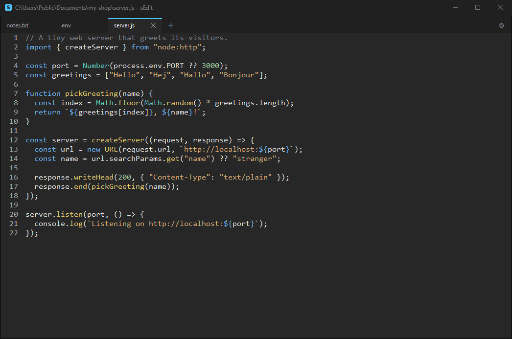
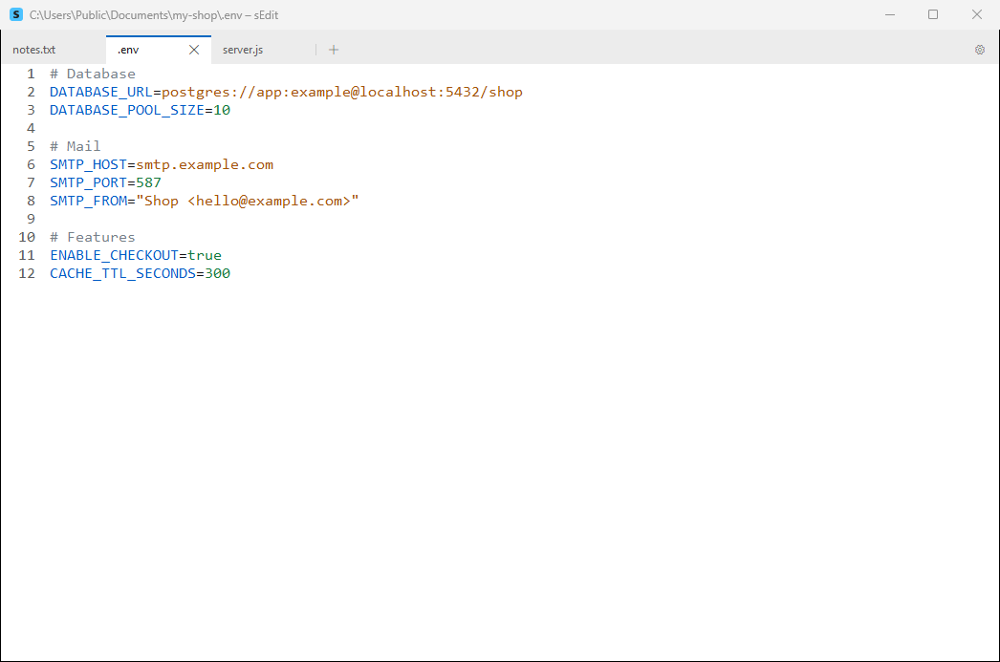
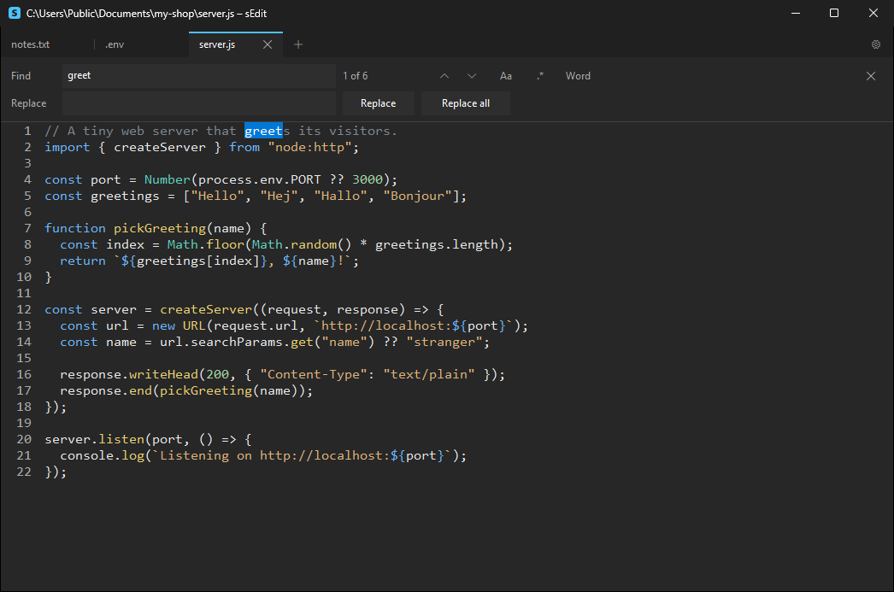
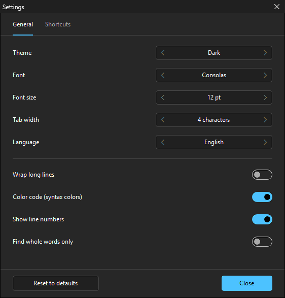

<div align="center">

# sEdit

**A tiny, instant notepad with tabs — for Windows.**

It opens the moment you click it, remembers everything you wrote,
and stays out of your way.

[**⬇ Download sEdit for Windows**](https://github.com/Andreas-DEV/sEdit/releases/latest/download/sEdit.exe)

<sub>One small file · Free · No installer · No account · Windows 10 and 11</sub>

<br>



<sub>🇩🇰 [Læs på dansk](README.da.md)</sub>

</div>

## What is sEdit?

sEdit is a notepad. You open it, you type, you save. That's the whole idea.

It is made for the small text jobs you do every day: jotting down a note,
fixing a line in a settings file, pasting something you need to keep for
five minutes. Big editors take a while to start and are full of buttons.
sEdit is open before you have let go of the mouse.

## What it can do

- **Tabs.** Keep many files open in one window and click between them.
- **It never loses your text.** Close sEdit without saving and your tabs and
  your unsaved text are right there the next time you open it.
- **Find and replace.** Search the text, step through every match, and swap
  one word for another.
- **Colors for code.** If you open a code or settings file, sEdit colors it so
  it is easier to read. It knows more than 30 kinds of files, among them
  `.env`, JSON, HTML, CSS, JavaScript, Python and Markdown.
- **Light and dark.** sEdit follows the look of your Windows, or you pick one
  yourself.
- **Your language.** 20 languages, including English, Danish, German, French
  and Spanish. It picks the one your Windows uses.
- **It notices changes.** If another program changes a file you have open,
  sEdit tells you and asks what to do. It never overwrites your work without
  asking.
- **Small.** The whole program is one file, smaller than a single phone photo.

| Light mode | Find and replace |
| :---: | :---: |
|  |  |

## How to install

There is nothing to install. sEdit is one file. You download it and open it.

### Step 1 — Download

Click this link:

### [⬇ Download sEdit.exe](https://github.com/Andreas-DEV/sEdit/releases/latest/download/sEdit.exe)

Your browser saves a file called **sEdit.exe**. It ends up in your
**Downloads** folder.

### Step 2 — Open it

Open your **Downloads** folder and double-click **sEdit**.

> **Can't find the Downloads folder?**
> Hold the **Windows key** (the one with the four squares, bottom left on your
> keyboard) and press **E**. A window opens. Click **Downloads** in the list on
> the left.

### Step 3 — If Windows shows a blue box

The first time, Windows may show a blue box that says
**"Windows protected your PC"**. This is normal. Windows shows it for every
small program it has not seen many times before.

1. Click the words **More info**.
2. Click the button **Run anyway**.

You only have to do this once.

### That's it

sEdit is open and you can start typing.

### Good to do afterwards (optional)

**Put sEdit where you can find it again.** While sEdit is open, look at the
row of icons at the bottom of your screen. Right-click the sEdit icon (the
blue **S**) and choose **Pin to taskbar**. From now on, sEdit is one click
away.

**Move it out of Downloads.** If you tend to empty your Downloads folder, drag
**sEdit** onto your Desktop or into Documents first, and pin it from there.

### How to remove sEdit

Delete the file **sEdit.exe**. That's all. sEdit does not spread itself around
your computer.

## How to use it

| I want to… | Do this |
| :--- | :--- |
| Start a new note | Click the **+** next to the tabs, or press **Ctrl + N** |
| Open a file | Press **Ctrl + O**, or drag the file into the sEdit window |
| Save | Press **Ctrl + S** |
| Save under a new name | Press **Ctrl + Shift + S** |
| Close a tab | Click the **×** on the tab, or press **Ctrl + W** |
| Go to the next tab | Press **Ctrl + Tab** |
| Jump straight to a tab | Press **Ctrl + 1** for the first tab, **Ctrl + 2** for the second, and so on |
| Find a word | Press **Ctrl + F** |
| Wrap long lines | Press **Alt + Z** |
| Open the settings | Click the little cog in the top right corner, or press **Ctrl + ,** |

"Ctrl + S" means: hold down the **Ctrl** key and press **S**.

## Settings

Click the cog in the top right corner. Here you choose light or dark, the
font and its size, the language, and whether you want line numbers. Under
**Shortcuts** you can change every keyboard shortcut to whatever suits you.

<div align="center">



</div>

## Questions

**Is it free?**
Yes.

**Does it send anything to the internet?**
No. sEdit never goes online. Your text stays on your computer.

**Where is my unsaved text kept?**
In a private folder on your own computer, so it is still there after a
restart. A file is only changed when you press save.

**Does it work on Mac or Linux?**
No, only Windows.

**Something is not working. What do I do?**
[Write to us here](https://github.com/Andreas-DEV/sEdit/issues) and describe
what happened.

## For developers

sEdit is written in Rust and talks directly to Windows, with no UI framework
in between. That is why it starts so fast and stays so small.

Build it yourself:

```powershell
cargo build --release
```

The finished program is `target\release\sedit.exe`.

To build it, copy it to a fixed place and add it to the "Open with" menu in
File Explorer:

```powershell
.\scripts\install.ps1
```

Undo that again with `.\scripts\install.ps1 -Uninstall`.
